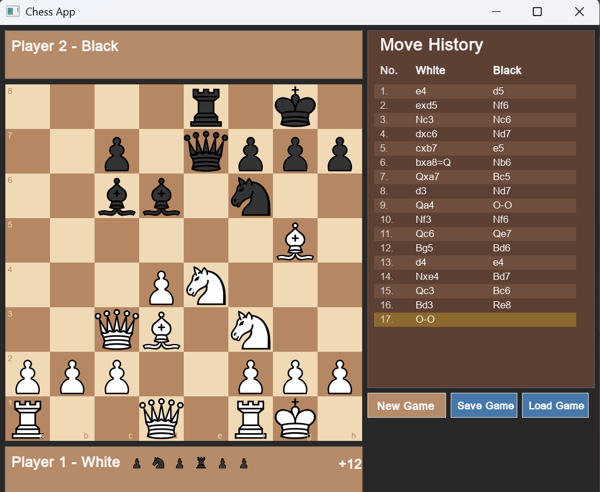

# Chess App

A desktop chess application developed using **C++** and **SFML 3.1.0**, allowing two players to play chess offline on the same computer.

The application provides a graphical chessboard, interactive piece movement, chess rule validation, game state management, move history, and save/load functionality.

---

## Table of Contents

- [Overview](#overview)
- [Features](#features)
- [Screenshots](#screenshots)
- [Gameplay](#gameplay)
- [Chess Rules and Game Logic](#chess-rules-and-game-logic)
- [Project Architecture](#project-architecture)
- [Technologies](#technologies)
- [Prerequisites](#prerequisites)
- [Build and Run](#build-and-run)
- [Saving and Loading](#saving-and-loading)
- [Project Structure](#project-structure)
- [Limitations](#limitations)
- [Future Improvements](#future-improvements)
- [Author](#author)

---

## Overview

Chess App is a local two-player chess application designed for desktop computers.

The application allows two players to play on the same computer using a shared window. Players take turns controlling the White and Black pieces through mouse interactions.

The project was developed to apply C++ programming, object-oriented programming concepts, event handling, game logic, and graphical user interface development using SFML.

### Game Mode

- **Local Two-Player:** Two players play on the same computer.
- **Offline Gameplay:** No Internet connection is required.
- **White Moves First:** The White player always takes the first turn.
- **Shared Interface:** Both players use the same application window.

## Features

### Chessboard and Interface

- 8 × 8 chessboard with alternating square colors.
- Graphical representation of all six chess piece types.
- Interactive piece selection and movement.
- Visual indicators for selected squares and possible moves.
- Move history display.
- Captured pieces display.
- Material advantage information.
- Player turn indication.
- New Game and Restart functionality.

### Chess Mechanics

- Legal move validation for all six piece types.
- Capture mechanics.
- Check detection.
- Checkmate detection.
- Stalemate detection.
- Castling.
- En passant.
- Pawn promotion to Queen, Rook, Bishop, or Knight.

### Draw Detection

The application supports several draw conditions:

- Threefold repetition.
- Fifty-move rule.
- Seventy-five-move rule.
- Insufficient material.

### Game Management

- Start a new game.
- Restart the current game.
- Save the current game.
- Load a previously saved game.
- Confirmation dialog before loading a saved game.
- Restore important game information when loading, including board state, turn, castling rights, en passant information, captured pieces, move history, and repetition data.

---

## Screenshots

Add screenshots of the application here.

Suggested screenshots:

| Screenshot | Description |
|---|---|
| Main Menu / Game Window | The main application interface |
| Gameplay | A chess game in progress |
| Move History | Display of previous moves |
| Pawn Promotion | Promotion selection interface |
| Game Over | Checkmate, stalemate, or draw state |
| Save / Load | Game saving and loading interface |

Example:

<p align="center">
  
</p>

---

## Gameplay

The application follows the standard turn-based chess system.

1. The game starts with the standard chess starting position.
2. White makes the first move.
3. The player selects one of their pieces using the mouse.
4. The player selects a destination square.
5. The application validates the move.
6. If the move is legal, the board state is updated.
7. The turn switches to the opposing player.
8. The process continues until the game reaches a checkmate, stalemate, or draw condition.

### Mouse Controls

| Action | Description |
|---|---|
| Left-click a piece | Select a piece |
| Left-click a destination square | Attempt to move the selected piece |
| Click another friendly piece | Change the current selection |
| Click an available interface button | Execute the corresponding action |

---

## Chess Rules and Game Logic

The application implements the movement rules and important special rules of chess.

### Piece Movement

| Piece | Movement |
|---|---|
| King | One square in any direction |
| Queen | Any number of squares horizontally, vertically, or diagonally |
| Rook | Any number of squares horizontally or vertically |
| Bishop | Any number of squares diagonally |
| Knight | Moves in an L-shaped pattern |
| Pawn | Moves forward and captures diagonally |

### Special Moves

**Castling**

Allows the King and Rook to move as part of one special move when the required conditions are satisfied.

**En Passant**

Allows a Pawn to capture an opposing Pawn that has just advanced two squares under the appropriate conditions.

**Pawn Promotion**

When a Pawn reaches the opposite end of the board, it can be promoted to one of the following pieces:

- Queen
- Rook
- Bishop
- Knight

### Game Ending Conditions

The application recognizes several ways a game can end:

- **Checkmate:** A player is in check and has no legal move to escape.
- **Stalemate:** A player has no legal moves but is not in check.
- **Draw:** The game reaches a supported draw condition.

---

## Project Architecture

The project is organized into separate components to improve readability, maintainability, and separation of responsibilities.

The main components include:

| Component | Responsibility |
|---|---|
| `Game` | Manages the game flow, state, and player interactions |
| `GameData` | Contains data structures used to represent game information |
| `BoardRenderer` | Handles chessboard and piece rendering |
| `UI` | Manages interface elements, dialogs, buttons, and move history |
| `SaveManager` | Handles saving, loading, and clearing saved game data |
| `main` | Initializes the application and manages the main window loop |

The architecture separates game management, rendering, user interface, and file operations instead of placing all application logic in a single source file.

### Design Principles

- Separation of responsibilities.
- Modular source code organization.
- Reusable components.
- Clear management of game state.
- Consistent separation between game logic and graphical rendering.
- Maintainable and extensible code structure.

---

## Technologies

| Technology | Purpose |
|---|---|
| C++ | Main programming language |
| SFML 3.1.0 | Graphics, window management, and input handling |
| CMake | Project configuration and build system |
| vcpkg | C++ dependency management |
| MSVC | C++ compiler |
| Visual Studio 2026 | Development environment |

### SFML Modules

The project uses SFML 3.1.0 for its graphical application functionality.

- **Graphics:** Rendering the chessboard, pieces, and interface elements.
- **Window:** Creating the application window and handling events.
- **System:** Supporting underlying SFML functionality.

Official resources:

- [SFML Official Website](https://www.sfml-dev.org/)
- [SFML 3.1.0 Documentation](https://www.sfml-dev.org/documentation/3.1.0/)
- [CMake Documentation](https://cmake.org/documentation/)
- [vcpkg Documentation](https://learn.microsoft.com/en-us/vcpkg/)

---

## Prerequisites

Before building the project, make sure the following tools are available:

- Windows 11.
- Visual Studio 2026 Community.
- Desktop development with C++ workload.
- MSVC C++ compiler.
- CMake.
- Git.
- vcpkg.
- SFML 3.1.0.

The project is configured for SFML 3.1.0. Using SFML 2.x may require code changes because the APIs differ between major versions.

---

## Build and Run

### 1. Clone the Repository

Open a terminal and run:

```bash
git clone https://github.com/duy123450/ChessApp.git
```

Navigate to the project directory:

```bash
cd ChessApp
```

### 2. Open the Project

Open the project folder in Visual Studio 2026.

Make sure Visual Studio recognizes the CMake project and loads its available build presets.

### 3. Configure Dependencies

The project uses vcpkg to manage SFML and its dependencies.

Make sure vcpkg is installed and configured correctly for the project before building.

### 4. Build the Project

Open the Visual Studio Developer PowerShell or another terminal configured for the MSVC compiler.

Run:

```powershell
cmake --build --preset x64-debug
```

### 5. Run the Application

After a successful build, run the application using Visual Studio or the generated executable.

---

## Saving and Loading

The application supports saving and restoring an ongoing chess game.

Game information is stored locally in:

```text
saved_game.txt
```

The save data includes:

- Current chessboard state.
- Current player's turn.
- Castling rights.
- En passant target information.
- Halfmove clock.
- Captured pieces.
- Move history.
- Position repetition information.
- Pending pawn promotion information.

This allows the application to restore the saved game rather than starting a completely new match.

---

## Project Structure

The project separates source code, header files, resources, and build configuration.

The main source components include:

```text
ChessApp/
│
├── CMakeLists.txt
├── CMakePresets.json
│
├── main.cpp
│
├── Game.h
├── Game.cpp
│
├── GameData.h
│
├── BoardRenderer.h
├── BoardRenderer.cpp
│
├── UI.h
├── UI.cpp
│
├── SaveManager.h
├── SaveManager.cpp
│
├── ...
│
└── saved_game.txt
```

The structure above highlights the main application components. Other source files and resources are omitted from this overview.

---

## Limitations

The current version focuses on local two-player gameplay.

The following features are outside the current project scope:

- Playing against a computer-controlled opponent.
- Online multiplayer.
- LAN multiplayer.
- User accounts and authentication.
- Online leaderboards.
- Chess engine analysis.
- Cloud synchronization.

The application is designed primarily for Windows desktop environments and the current Visual Studio/MSVC development setup.

---

## Future Improvements

Potential improvements for future versions include:

- Computer-controlled opponents using a chess engine.
- Online multiplayer functionality.
- LAN multiplayer support.
- Chess clocks and time controls.
- Improved animations and visual effects.
- Customizable board themes and piece styles.
- PGN import and export.
- Undo and redo functionality.
- Enhanced game statistics.
- Cross-platform support.

These improvements are possible extensions and are not part of the current feature set.

---

## Author

**Duy**

GitHub: [@duy123450](https://github.com/duy123450)

## License

No license has currently been specified for this project. Please check the repository for licensing information before redistributing or reusing the source code.